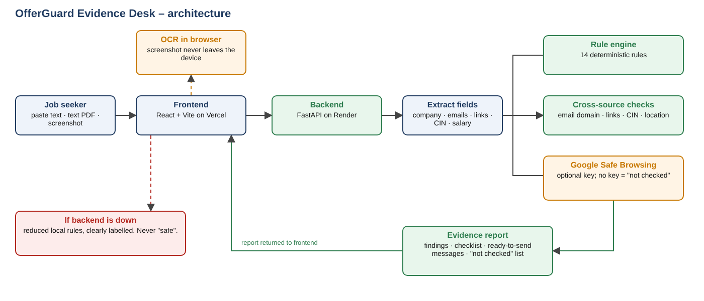

# 🛡️ OfferGuard Evidence Desk

**Explainable job-offer risk checker.** Paste a recruitment message, upload a text PDF or upload a chat screenshot. Get an evidence report: which warning signs were found, the exact words behind each one, live lookup results, what could not be verified, and what to do next.

> OfferGuard does not claim to prove whether a job offer is genuine. It finds explainable warning signs, runs the checks it can, shows what it could not verify, and helps job seekers decide what to confirm before paying or sharing anything. It never says an offer is "safe".

🔗 **Live demo:** [offerguard-psi.vercel.app](https://offerguard-psi.vercel.app)
⚙️ **API docs:** [offerguard-api-20f2.onrender.com/docs](https://offerguard-api-20f2.onrender.com/docs) (free hosting: the first request can take about a minute to wake the server)
🎥 **Demo video:** [EDIT: paste your video link]
📄 **Supporting document:** [`docs/OfferGuard_Supporting_Document.pdf`](docs/OfferGuard_Supporting_Document.pdf) (architecture, tech stack, limitations)
🏆 **Built for:** FirstHack, Open Innovation track (solo)
👤 **Author:** [Kasturi Adakure](https://github.com/kasturi181)

---

## Table of contents
1. [Problem](#problem)
2. [Solution](#solution)
3. [Why not just Google or a chatbot?](#why-not-just-google-or-a-chatbot)
4. [Features](#features)
5. [The 19 rules](#the-19-rules)
6. [Architecture](#architecture)
7. [Tech stack](#tech-stack)
8. [Project structure](#project-structure)
9. [API](#api)
10. [Run locally](#run-locally)
11. [Environment variables](#environment-variables)
12. [Deploy](#deploy)
13. [Testing and evaluation](#testing-and-evaluation)
14. [Limitations](#limitations)
15. [Roadmap](#roadmap)
16. [License](#license)

---

## Problem
Fake job offers that ask for registration fees, OTPs or identity documents target students and freshers every day. Checking one by hand means searching the company, the recruiter's email, the website and the registration number. Most people skip it, or do not know what to look for.

## Solution
OfferGuard turns one message, PDF or screenshot into one traceable report. There is no black-box score. Every warning links to the exact text that triggered it, and every check that could not run is listed as "not checked", never as "safe".

## Why not just Google or a chatbot?
| | Search / chatbot | OfferGuard |
|---|---|---|
| Looks at the domains in *your* message | No | Yes: domain age, DNS and mail records, real redirect destination |
| Decodes the Indian CIN | Generic advice | Decodes state, year and company type, and catches contradictions |
| Same answer every time | No | Yes: fixed, auditable rules, no AI guessing |
| Shows which words are the problem | No | Yes: highlighted evidence for every finding |
| Says what it could not check | Rarely | Always: "not checked" list |
| Privacy | Message goes to a third party | No account, offer text not stored, screenshots read in your browser |

## Features
- **Paste, PDF or screenshot.** Screenshots are read on the user's device with OCR (tesseract.js). The image is never uploaded.
- **Live lookups, no API key.** Domain age (RDAP), DNS and mail-server records (DNS-over-HTTPS), and a redirect trace that shows where a link really goes. Redirect tracing refuses private addresses, odd ports and IP literals, and never downloads page content.
- **Offline CIN decoder.** Reads the company registration number (listed or unlisted, state, incorporation year, company type) and flags contradictions such as "Private Ltd" with a public-company code, or "operating since 1998" with a 2015 CIN.
- **Look-alike domain patterns.** Free site-builder pages, link shorteners, risky domain endings, hyphen-heavy names and "company-name plus hiring-word" imitations.
- **Cross-source consistency.** Recruiter email domain, link domains, CIN and city are compared with the company record.
- **Evidence ledger.** Claim, exact matched text, source, check status, why it matters, uncertainty and next action for each finding.
- **Evidence highlighted inside your original message.**
- **Tailored safety checklist** matched to the findings (cybercrime.gov.in, helpline 1930, MCA lookup).
- **Ready-to-send verification messages** to the recruiter and to the company's official HR, plus notes for a cybercrime report.
- **Honest failure handling.** Unavailable checks go under "Not checked". A "Simulate URL check failure" toggle demonstrates this.
- **Local fallback.** If the backend is unreachable, the frontend runs a reduced rule set and labels it clearly.
- **Transparent risk indicator.** A rule-count level (high / elevated / some / none). Not a fraud probability.
- **Evaluation tab.** The rules are measured on 20 synthetic, manually labelled messages (precision 0.90, recall 0.90), with every failure shown openly.
- **Save report as PDF** (print-friendly layout).
- **Optional Supabase layer** (history, dashboard, user scam reports). Coded and switched on with environment variables. Not enabled in the live demo, so the Dashboard and Report tabs stay hidden.

## The 19 rules
| # | Rule | Severity |
|---|---|---|
| 1 | Upfront registration / processing / security fee | Strong |
| 2 | OTP, password, PIN or banking credential request | Strong |
| 3 | Link flagged by Google Safe Browsing (optional key) | Strong |
| 4 | Recruiter domain differs from the company record | Medium |
| 5 | Personal email used for corporate hiring | Medium |
| 6 | Identity / banking documents requested early | Medium |
| 7 | Guaranteed selection or time pressure | Medium |
| 8 | Implausible salary for an entry-level role | Medium |
| 9 | Redirect to Telegram / WhatsApp / external form | Weak |
| 10 | Company or recruiter not independently verified | Info |
| 11 | Link points away from the company's official domain | Medium |
| 12 | CIN differs from the company record | Medium |
| 13 | Offer city differs from the recorded office | Weak |
| 14 | Details match unverified user reports (needs database) | Weak |
| 15 | **Very new domain** (live): under 30 days strong, under 180 medium | Strong / Medium |
| 16 | **Domain has no website or no mail server** (live) | Medium |
| 17 | **Link redirects to a different site** (live) | Medium |
| 18 | **Look-alike, free-hosted, shortened or risky-ending domain** | Medium |
| 19 | **CIN malformed or self-contradictory** (offline decoder) | Medium |

## Architecture


```
Browser (React + Vite, Vercel)
  -> screenshot to text in the browser (Tesseract.js)
  -> POST /analyze or /analyze-pdf
FastAPI backend (Render)
  1 validate input, PDF to text (pypdf)
  2 extract fields: company, emails, links, CIN, salary, phones, cities
  3 checks: company record, live lookups, CIN decoder, optional Safe Browsing
  4 rule engine: 19 deterministic rules
  5 assessment + checklist + drafts -> JSON evidence report
Backend down? -> reduced local rules in the browser, clearly labelled
```

## Tech stack
| Layer | Tool |
|---|---|
| Frontend | React 18, Vite 5, plain CSS (light and dark) |
| OCR | tesseract.js (in the browser) |
| Backend | Python 3.12, FastAPI, Pydantic, Uvicorn |
| HTTP client | httpx (async) |
| PDF parsing | pypdf |
| Live data (no key) | RDAP (rdap.org), Cloudflare DNS-over-HTTPS |
| Optional | Google Safe Browsing v4, Supabase (Postgres via REST) |
| Tests | pytest, FastAPI TestClient (38 tests, network mocked) |
| Hosting | Vercel (frontend), Render (backend) |

## Project structure
```
.
├── frontend/              React + Vite app
│   └── src/
│       ├── App.jsx, api.js, styles.css, main.jsx
│       ├── views/         AnalyzeView, EvalView, DashboardView, ReportView
│       ├── report/        EvidenceLedger, FindingCard, Checklist, Drafts, ...
│       └── fixtures/      demoCases.js (fictional examples)
├── backend/               FastAPI app
│   ├── main.py            endpoints
│   ├── rules.py           19 deterministic rules
│   ├── extract.py         field extraction + PDF text
│   ├── checks/            company_identity, live, url_reputation, community
│   ├── guidance.py, explain.py, drafts.py, benchmark.py
│   ├── fixtures/          company_records.json, benchmark.json (synthetic)
│   └── tests/             rules, API and live-check tests
├── docs/                  architecture diagram, supporting PDF, demo script, test messages
└── README.md
```

## API
| Method | Path | Description |
|---|---|---|
| GET | `/health` | `{"status":"healthy","database":false}` |
| POST | `/analyze` | body `{"text": "...", "simulate_url_failure": false}` returns a report |
| POST | `/analyze-pdf` | multipart field `file` (text PDF, max 5 MB) |
| GET | `/benchmark` | rule evaluation on 20 synthetic labelled messages |
| POST | `/report`, GET `/stats`, GET `/history` | optional, need Supabase |

Report keys: `extracted_fields`, `findings`, `checks`, `assessment`, `missing_checks`, `limitations`, `checklist`, `drafts`, `mode`.
Check statuses: `verified_match`, `warning`, `no_match`, `unavailable`, `not_checked`.

```bash
curl -X POST http://127.0.0.1:8000/analyze \
  -H "Content-Type: application/json" \
  -d '{"text":"Pay a refundable registration fee of Rs 2000 today."}'
```

## Run locally
**Backend**
```bash
cd backend
python -m venv .venv
.venv\Scripts\activate            # macOS/Linux: source .venv/bin/activate
pip install -r requirements.txt
python -m uvicorn main:app --reload --port 8000
```
Open http://127.0.0.1:8000/docs

**Frontend** (new terminal)
```bash
cd frontend
copy .env.example .env            # macOS/Linux: cp .env.example .env
npm install
npm run dev
```
Open http://localhost:5173

## Environment variables
Backend (`backend/.env`):
```
FRONTEND_ORIGIN=https://your-frontend.vercel.app
SAFE_BROWSING_API_KEY=        # optional
OFFERGUARD_LIVE=1             # set 0 to switch live lookups off
SUPABASE_URL=                 # optional
SUPABASE_SERVICE_KEY=         # optional, server-side only, never in the frontend
```
Frontend (`frontend/.env`):
```
VITE_API_BASE_URL=http://127.0.0.1:8000   # no trailing slash
```
Never commit `.env` files. Only `.env.example` is tracked.

## Deploy
- **Backend:** Render Web Service. Root Directory `backend`, build `pip install -r requirements.txt`, start `uvicorn main:app --host 0.0.0.0 --port $PORT`, env `PYTHON_VERSION=3.12.7`. Check `/health`.
- **Frontend:** Vercel. Root Directory `frontend`, Vite preset, set `VITE_API_BASE_URL` to the backend URL (as a normal variable, not a secret).
- Set the backend `FRONTEND_ORIGIN` to the frontend URL.
- Both redeploy automatically on `git push` to `main`. Changing a `VITE_` variable needs a frontend redeploy.
- **Optional database:** run `supabase.sql` in the Supabase SQL editor, then set `SUPABASE_URL` and `SUPABASE_SERVICE_KEY` on the backend.

## Testing and evaluation
```bash
cd backend
python -m pytest -q
```
38 tests cover each rule, false positives (for example "no registration fee" is not flagged), input validation, bad PDFs, the CIN decoder, domain patterns and the live checks. Live checks are tested with simulated network responses, so the tests need no internet.

The **Evaluation** tab (`GET /benchmark`) runs the rules on 20 synthetic, manually labelled messages: 9 true positives, 1 false positive, 9 true negatives, 1 false negative. This measures the rules on examples written by the author, not real-world accuracy.

## Limitations
Full list (21 points) in [`docs/OfferGuard_Supporting_Document.pdf`](docs/OfferGuard_Supporting_Document.pdf). Main ones:
- Warning signs are not proof of fraud. No warning signs is not proof of safety.
- The risk level counts triggered rules. It is not a probability.
- MCA has no public API, so a CIN is decoded from its format only and is not looked up. A well-formed fake CIN passes. Verify on mca.gov.in.
- Company records are a small synthetic sample, not an official registry.
- Domain age comes from public registry data, which can be hidden or wrong. A new domain can be a real startup.
- Scanned PDFs are not read directly. Upload a screenshot instead. OCR can misread characters, so check the text.
- Rules cover common patterns, so new scam wording can be missed.
- Free hosting sleeps when idle. The first request can take 30-60 seconds, and live lookups add 5-15 seconds.
- No accounts and no saved history in the live demo.

## Roadmap
- [x] Evidence highlighted inside the original text
- [x] Per-report checklist and ready-to-send messages
- [x] Screenshot OCR
- [x] Live domain, DNS and redirect checks
- [x] Offline CIN decoder
- [x] Exportable PDF report (print to PDF)
- [ ] Official registry integration (MCA data licence)
- [ ] Hindi and Hinglish message patterns
- [ ] Accounts with saved history
- [ ] Moderated community blocklist
- [ ] Browser extension

## License
MIT. See [LICENSE](LICENSE).

---
Disclaimer: OfferGuard is decision support, not legal advice. Verify any employer independently before paying or sharing documents.
